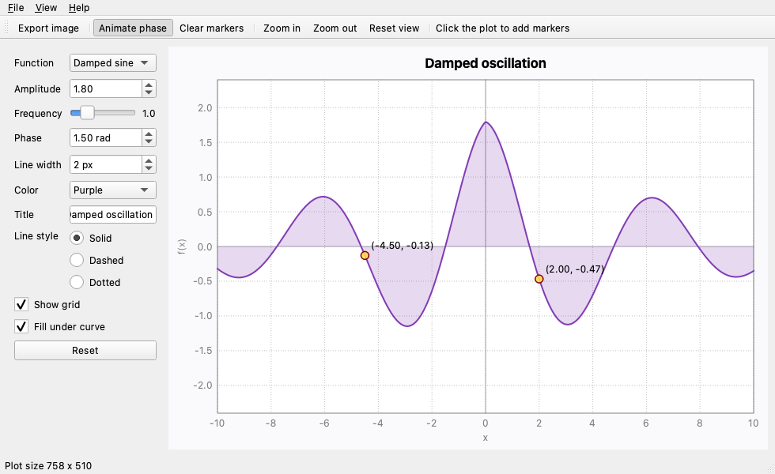
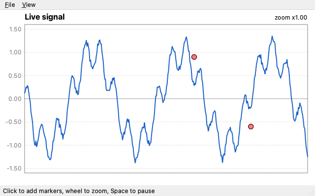
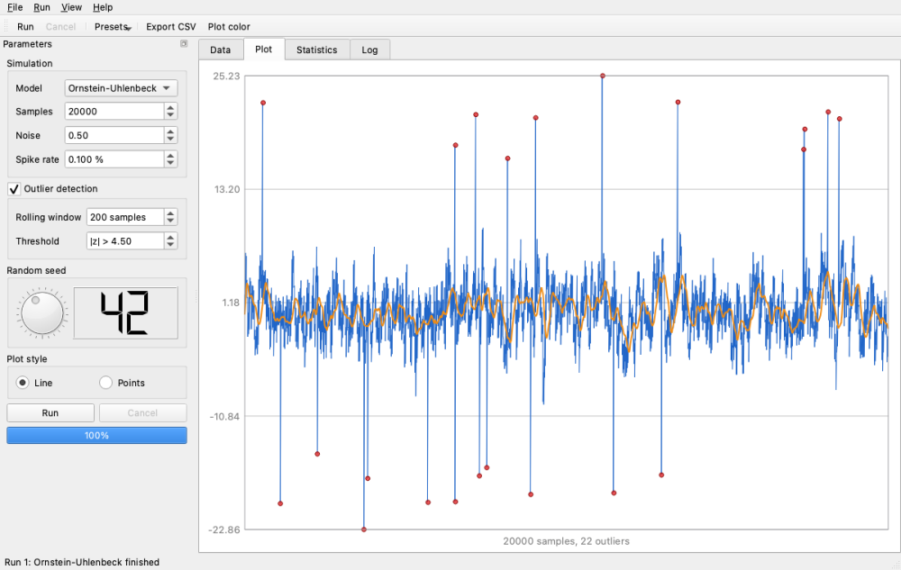
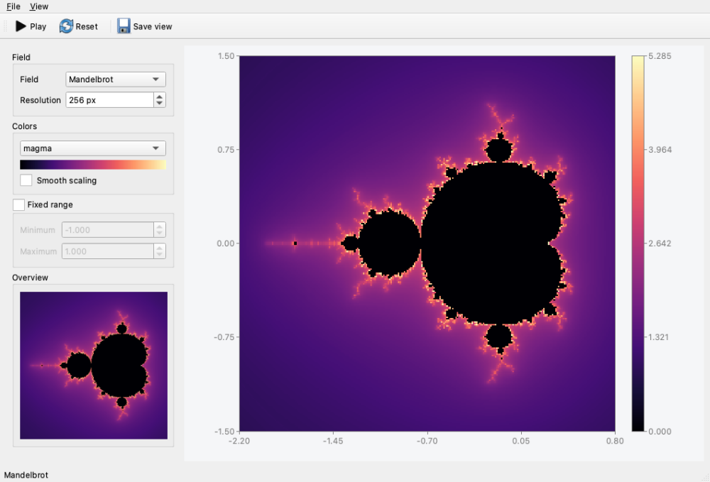
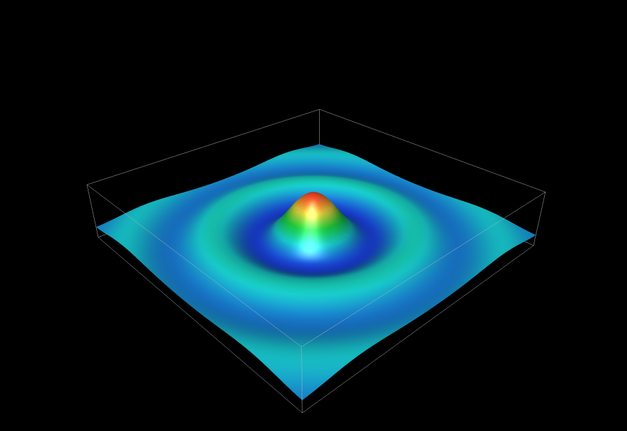
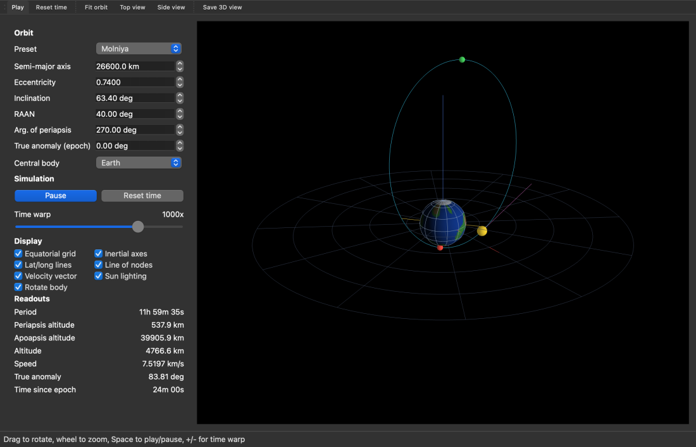
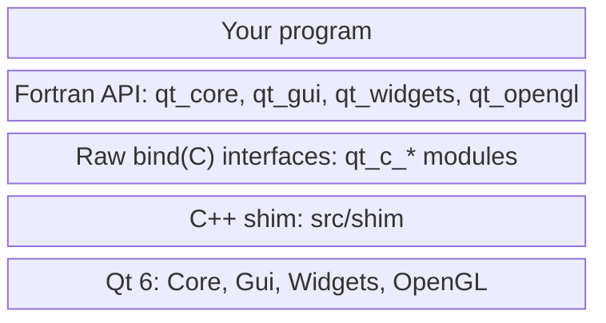

# qt-fortran

**A Modern Fortran interface to [Qt 6](https://www.qt.io/).** Build desktop GUI
applications (windows, widgets, menus, dialogs and custom painting) entirely
in Fortran.

qt-fortran does for Fortran what [PySide6](https://doc.qt.io/qtforpython-6/)
does for Python. It wraps the Qt C++ API in a native, object-oriented Fortran
API, using only standard C interoperability (`iso_c_binding`). There are no
compiler extensions, and you never write C++.



*The [Function Explorer](example/explorer.f90) example, written in about 800 lines of Fortran.*

> **Status: early development.** The API covers QtCore, QtGui, QtWidgets
> and modern OpenGL essentials and is tested on Linux, macOS and Windows, but it may still change.

## A taste

```fortran
module hello_slots
    use qt
    implicit none
contains
    subroutine on_click(data)
        class(*), intent(inout), optional :: data
        select type (data)
        type is (QLabel)
            call data%setText('Hello from Fortran!')
        end select
    end subroutine on_click
end module hello_slots

program hello
    use qt
    use hello_slots
    implicit none
    type(QApplication) :: app
    type(QWidget) :: window
    type(QVBoxLayout) :: layout
    type(QLabel), target :: label
    type(QPushButton) :: button

    app = QApplication()
    window = QWidget()
    call window%setWindowTitle('qt-fortran')
    layout = QVBoxLayout(window)
    label = QLabel('Click the button')
    button = QPushButton('Greet')
    call layout%addWidget(label)
    call layout%addWidget(button)

    call button%clicked%connect(on_click, label)   ! signal -> Fortran slot

    call window%show()
    stop app%exec()
end program hello
```

If you know Qt or PySide, this should look familiar. The class and method names
are Qt's, so the [Qt documentation](https://doc.qt.io/qt-6/) applies directly.

## Features

- **Qt-style object API**: derived types follow the Qt class hierarchy
  (`QObject` → `QWidget` → `QAbstractButton` → `QPushButton`), with constructors
  named after the class (`QLabel('text', parent)`) and type-bound methods
  (`label%setText(...)`).
- **Signals and slots**: signals are components of the object, as in PySide:
  `call timer%timeout%connect(on_tick, state)`.
  - Slots are ordinary Fortran procedures. They receive the signal's arguments
    (none, logical, integer, real, string, or an event) and any user data you
    attach, as `class(*)`.
  - Connections are released automatically when Qt destroys the sender.
- **Custom widgets**: `QtfWidget` delivers `paintEvent`, mouse, wheel, keyboard
  and resize events to Fortran slots, so you can draw anything with `QPainter`.
- **3D graphics with modern OpenGL**: `QtfOpenGLWidget` delivers `initializeGL` /
  `paintGL` to Fortran slots.
  - Shader programs, buffers and vertex array objects come from Qt's helpers.
  - Vertex data comes straight from Fortran arrays.
  - `QMatrix4x4` (perspective, lookAt, rotations, ...) is implemented in pure Fortran.
- **Strings**: UTF-8 in both directions, using ordinary `character(len=*)` and
  `character(len=:), allocatable`.
- **Cross-platform**: Linux, macOS and Windows, built and tested in CI with
  gfortran on all three.
- **Generated bindings**: most of the API is generated from compact TOML specs,
  so adding a Qt method is usually a one-line change (see [Development](#development)).

### What's covered

| Area | Classes |
|------|---------|
| Core | `QObject`, `QTimer`, `QEvent` |
| Application | `QApplication` |
| Widgets | `QWidget`, `QFrame`, `QLabel`, `QPushButton`, `QToolButton`, `QCheckBox`, `QRadioButton`, `QButtonGroup`, `QLineEdit`, `QSpinBox`, `QDoubleSpinBox`, `QSlider`, `QDial`, `QComboBox`, `QProgressBar`, `QLCDNumber`, `QDateEdit`, `QTimeEdit`, `QCalendarWidget`, `QtfWidget` (custom painting/events) |
| Text | `QTextEdit`, `QPlainTextEdit` |
| Item views | `QTableWidget`, `QListWidget`, `QTreeWidget`, and `QTableView` with `QtfTableModel` (cells come from Fortran on demand, so large arrays aren't copied) |
| Containers | `QTabWidget`, `QStackedWidget`, `QSplitter`, `QScrollArea`, `QGroupBox`, `QDockWidget` |
| Layouts | `QVBoxLayout`, `QHBoxLayout`, `QGridLayout`, `QFormLayout`, size policies |
| Main window | `QMainWindow`, `QMenuBar`, `QMenu`, `QToolBar`, `QStatusBar`, `QAction`, docks |
| Dialogs | `QDialog`, `QMessageBox`, `QFileDialog`, `QInputDialog`, `QColorDialog`, `QFontDialog`, `QProgressDialog` |
| Painting | `QPainter`, `QImage`, `QPixmap`, `QColor`, `QPen`, `QBrush`, `QFont` |
| Arrays as images | `QImage_fromArray` (a 2D Fortran array through a colormap: viridis, magma, inferno, plasma, coolwarm, gray; NaN transparent), `QImage_colorbar` |
| Icons | `QIcon` (files or generated images), `QStyle_standardIcon`, icons on actions, buttons, tabs, items and windows |
| Input events | `QMouseEvent`, `QKeyEvent`, `QWheelEvent`, `QResizeEvent` |
| OpenGL | `QtfOpenGLWidget`, `QOpenGLShaderProgram`, `QOpenGLBuffer`, `QOpenGLVertexArrayObject`, `QSurfaceFormat`, `QMatrix4x4`, and `glClear`, `glDrawArrays`, `glDrawElements`, ... |

## Getting started

### Requirements

Everything comes from [conda-forge](https://conda-forge.org/) through
[pixi](https://pixi.sh): Qt 6 (via `pyside6`), gfortran 15, a C++ compiler,
fpm, and Python (for the build tools). Install pixi, then:

```sh
git clone https://github.com/jacobwilliams/qt-fortran.git
cd qt-fortran
pixi install
```

On **Windows**, conda-forge's Qt is built with MSVC, so the
[Visual Studio Build Tools](https://visualstudio.microsoft.com/visual-cpp-build-tools/)
must be installed. The C++ part of qt-fortran is compiled with clang in MSVC
mode. Fortran is still gfortran.

### Build, test, run

```sh
pixi run build                  # build the library and examples
pixi run test                   # run the test suite (headless)
pixi run example hello          # run an example: hello, timer, form, plot, explorer, timeseries, fieldviewer, surface3d, orbit3d
```

Examples:

| Example | Shows |
|---------|-------|
| [hello](example/hello.f90) | the smallest possible window |
| [timer](example/timer.f90) | `QTimer` and slots with user data |
| [form](example/form.f90) | input widgets, layouts, validation, a message box |
| [plot](example/plot.f90) | a live scrolling plot with `QtfWidget` and `QPainter` |
| [explorer](example/explorer.f90) | a tour of nearly everything: menus, toolbar, all control types, custom painting, mouse/keyboard/wheel input, animation, file and message dialogs |
| [timeseries](example/timeseries.f90) | a simulation workbench: a dock of parameters (group boxes, form layouts, dial + LCD, radio group), cancellable chunked runs with a progress bar, tabs with a splitter, a million-row table served from Fortran arrays (`QtfTableModel`), a statistics tree, a log console, a tool-button preset menu, input and color dialogs |
| [fieldviewer](example/fieldviewer.f90) | 2D fields computed in Fortran shown with `QImage_fromArray`: interference, masked peaks (NaN), Mandelbrot, and an interactive heat-diffusion solver; colormaps, colorbar, hover readout, standard icons |
| [surface3d](example/surface3d.f90) | an interactive 3D surface plot with modern OpenGL: GLSL shaders, an indexed mesh with lighting, orbit/zoom with the mouse, auto-rotation, PNG export |
| [orbit3d](example/orbit3d.f90) | a spacecraft orbit viewer: Kepler propagation, orbital elements and presets in a side panel, a rotating lit planet, time warp, live readouts, OpenGL 3D view |

The `plot` and `explorer` examples can render themselves to an image without
opening a window, which is handy on servers and in CI:

```sh
QT_QPA_PLATFORM=offscreen pixi run example explorer -- --screenshot explorer.png
```



The OpenGL example needs a display with OpenGL 3.3 (the offscreen platform has
no OpenGL), but can still save a screenshot and exit:

```sh
pixi run example surface3d -- --screenshot surface.png
```









### Using qt-fortran in your own project

qt-fortran is an ordinary [fpm](https://fpm.fortran-lang.org/) dependency. Add
it to your project's `fpm.toml`:

```toml
[dependencies]
qt-fortran = { git = "https://github.com/jacobwilliams/qt-fortran" }
```

fpm builds everything, including qt-fortran's small C++ part (the "shim" that
talks to Qt), and links Qt into your programs. Qt is C++, so fpm needs to know
three machine-specific settings, through its standard environment variables:

| Variable | Contents |
|----------|----------|
| `FPM_CXX` | the C++ compiler: `clang++` on macOS, `g++` on Linux |
| `FPM_CXXFLAGS` | `-std=c++17 -fPIC` plus Qt's include paths |
| `FPM_LDFLAGS` | Qt's library directory, and an rpath to it |

qt-fortran's helper script computes them from `pkg-config`. After fpm has
fetched the dependency (`fpm update`), run this in your project root:

```sh
eval "$(python build/dependencies/qt-fortran/tools/fpm_qt.py --env)"
fpm run
```

Instead of exporting the variables, you can let the script run fpm with them
(`python build/dependencies/qt-fortran/tools/fpm_qt.py run`). Or set the
variables yourself, e.g. on Linux:

```sh
QT="Qt6Core Qt6Gui Qt6Widgets Qt6OpenGL Qt6OpenGLWidgets"
export FPM_CXX=g++
export FPM_CXXFLAGS="-std=c++17 -fPIC $(pkg-config --cflags $QT)"
export FPM_LDFLAGS="$(pkg-config --libs-only-L $QT) -Wl,-rpath,$(pkg-config --variable=libdir Qt6Core)"
```

The Qt libraries and the C++ runtime are declared in qt-fortran's own `fpm.toml`,
so you don't need to list them. [`ci/consumer`](ci/consumer) is a complete
minimal project; CI builds and runs it on all three platforms.

**Where Qt comes from:**
- **pixi/conda-forge (recommended):** add `qt6-main`, `gfortran`, `fpm`,
  `cxx-compiler` and `pkg-config` to your environment (see this repository's
  [pixi.toml](pixi.toml)).
- **Linux distribution packages** (Qt 6 development files and pkg-config) should
  also work.
- **Not yet supported:**
  - Homebrew's Qt on macOS, which ships only as frameworks.
  - MSYS2's MinGW Qt on Windows. It is supported by design but untested.
- **Windows with conda-forge:** Qt there is built with MSVC, which gfortran can't
  link directly. Use the helper script, which builds the C++ part as a small DLL
  (`build/qtf/qtf.dll`) and links it for you.

## Programming guide

A few conventions to know (the full list is in [plan.md](plan.md)):

- **Slots** are module procedures with a final optional `data` argument:

  ```fortran
  subroutine on_value(value, data)
      integer, intent(in) :: value
      class(*), intent(inout), optional :: data
      select type (data)
      type is (my_state)
          data%count = value
      end select
  end subroutine on_value
  ```

  - **Data**: the `data` passed to `connect` is stored by reference, so it needs
    the `target` attribute and must outlive the connection. Keep application
    state in one derived type and pass it to every slot.
  - **Location**: put slots in a module, not as internal procedures that use
    host variables (those need non-portable compiler trampolines).
- **Ownership** follows Qt's parent/child model.
  - Widgets with a parent, or placed in a layout, are deleted by Qt.
  - Delete top-level objects with `%delete()`.
  - Images, pixmaps, painters on images and synthetic events created from
    Fortran are also released with `delete` / `end`.
- **Enums** are integer constants:
  - Qt namespace values are `Qt_AlignCenter`, `Qt_Key_A`, ….
  - Class enums are `QMessageBox_Yes`, `QDialog_Accepted`, …. Combine flags with `ior`.
  - Fortran is case-insensitive, so a constant that would clash with a function
    gets its enum name too: `QMessageBox_Icon_Information`.
- **Static methods** are free procedures named `Class_method`:
  `QMessageBox_question`, `QFileDialog_getOpenFileName`, `QTimer_singleShot`,
  `QApplication_quit`.
- **Indices are 0-based** (combo box items, grid rows/columns), as in Qt.
- **Reals** are `real(c_double)` (i.e. real64); drawing methods accept integer
  or real coordinates.
- **Arrays as images**: `img = QImage_fromArray(field, 'viridis', flipY=.true.)`
  maps `field(i, j)` to pixel (x, y). `flipY` puts j = 1 at the bottom, as in a
  plot. Draw the image scaled with `painter%drawImage(x, y, w, h, img)`, or show
  it in a label with `label%setPixmap(QPixmap_fromImage(img))`. Delete images
  and pixmaps you create.
- **String lists** (header labels, combo and list items) are character arrays;
  trailing blanks are trimmed, e.g. `call table%setHorizontalHeaderLabels(['Name ', 'Value'])`.
  - **gfortran pitfall:** don't put a function result into a type-spec array
    constructor, as in `[character(len=40) :: 'n', itoa(n)]`. gfortran 15
    miscompiles it and corrupts the heap. Assign the elements to a fixed-length
    array first.

## How it works



- **The shim** exposes Qt as flat C functions (`qtf_qlabel_setText(void*,
  const char*, int)`), with Qt objects passed as opaque pointers. fpm compiles
  it into the qt-fortran library with a C++ compiler that matches Qt's ABI.
  - On Windows with conda-forge's MSVC-built Qt, it's built as a separate DLL
    instead. Its interface is pure C, so MinGW gfortran can link it.
- **Signals** are connected in C++ with lambdas that call one Fortran
  `bind(C)` dispatcher. The dispatcher looks up the Fortran slot (a procedure
  pointer) and its user data in a registry. Qt's `moc` isn't needed.
- **Virtual functions** (e.g. `paintEvent`) are overridden by a small C++
  subclass, `QtfWidget`, which forwards each event to Fortran slots.

## Development

### Repository layout

```
spec/       binding specs (TOML): widgets.toml, gui.toml, opengl.toml
src/        Fortran sources: core/ (hand-written), gui/, widgets/, opengl/ (mostly generated), qt.f90
src/shim/   C++ shim: qtf_common.h, qtf_core.cpp (hand-written); qtf_gui.cpp, qtf_widgets.cpp,
            qtf_opengl.cpp (generated)
ci/consumer a separate fpm project that depends on qt-fortran (CI check and template)
tools/      fpm_qt.py, gen_bindings.py, gen_c_interfaces.py, check_fortran.py
test/       headless test programs (one per area)
example/    example applications
plan.md     design decisions, conventions and project history
```

### Adding to the API

Most bindings are generated. A class in `spec/widgets.toml` looks like this:

```toml
[[class]]
name = "QSpinBox"
base = "QWidget"
doc = "An integer spin box."
ctor = "(parent: QWidget?) -- Create a spin box (range 0..99)."
signals = ["valueChanged: int -- The value changed."]
methods = [
    "setRange(minimum: int, maximum: int) -- Set the allowed range.",
    "value() -> int -- The current value.",
]
```

From this, [`tools/gen_bindings.py`](tools/gen_bindings.py) generates:
- the C++ shim functions;
- the Fortran type, constructor, type-bound procedures and signal wiring.

[`tools/gen_c_interfaces.py`](tools/gen_c_interfaces.py) then generates the raw
`bind(C)` interfaces from the shim. To add an API:

1. Edit the spec. The format is documented at the top of `gen_bindings.py`. It
   covers strings, logicals, enums, object handles, optional arguments with
   defaults, static functions, integer-or-real overloads, value types, signals,
   and verbatim C++/Fortran for anything irregular.
2. Run `pixi run gen`.
3. Add a check to the tests and run `pixi run test`.

Never edit generated files (they say so at the top). `pixi run gen-check` fails
if any of them is stale.

### Checks

```sh
pixi run test        # headless tests (QT_QPA_PLATFORM=offscreen); the OpenGL test SKIPs here
pixi run test-gl     # the OpenGL test on the real display
pixi run lint        # every procedure/type documented; implicit none in interface bodies
pixi run gen-check   # generated files up to date
```

CI ([.github/workflows/ci.yml](.github/workflows/ci.yml)) builds and tests on
Ubuntu, macOS and Windows, runs `lint` and `gen-check`, and runs the OpenGL test
on macOS (the only runner with a window server).

### Code style

- Every module, procedure and type has a [FORD](https://forddocs.readthedocs.io)
  docstring (`!>` before, `!!` after).
- API docs can be generated with `ford ford.md`.
- Fortran sources are ASCII. Tests build UTF-8 strings from explicit bytes.

## Roadmap

- Smoother packaging: a conda-forge package, and Homebrew (framework) Qt support.
- More of Qt: background computation, close events and `QSettings`, and Qt
  Charts / Qt Graphs. See the roadmap in [plan.md](plan.md).
- Seeding specs from PySide6's type-system XML files to cover more of the API
  faster.

See [plan.md](plan.md) for the design history and the reasoning behind the
decisions above.

## License

MIT. See [LICENSE](LICENSE).
