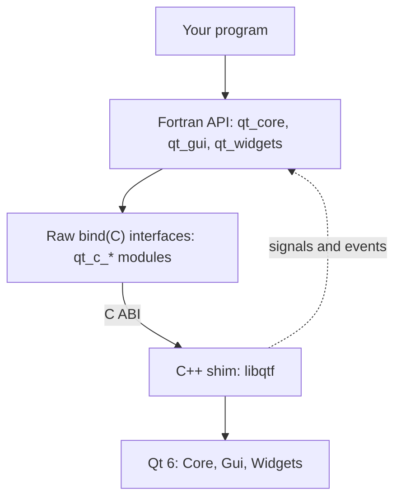

# qt-fortran

**A Modern Fortran interface to [Qt 6](https://www.qt.io/).** Build desktop GUI
applications (windows, widgets, menus, dialogs and custom painting) entirely
in Fortran.

qt-fortran does for Fortran what [PySide6](https://doc.qt.io/qtforpython-6/)
does for Python. It wraps the Qt C++ API in a native, object-oriented Fortran
API, using only standard C interoperability (`iso_c_binding`). There are no
compiler extensions, and you never write C++.


*The [Function Explorer](example/explorer.f90) example, written in about 800 lines of Fortran.*

> **Status: early development.** The API covers QtCore, QtGui and QtWidgets
> essentials and is tested on Linux, macOS and Windows, but it may still change.

## A taste

```fortran
module hello_slots
    use qt
    implicit none
contains
    subroutine on_click(data)
        class(*), intent(inout), optional :: data
        select type (data)
        type is (QLabel)
            call data%setText('Hello from Fortran!')
        end select
    end subroutine on_click
end module hello_slots

program hello
    use qt
    use hello_slots
    implicit none
    type(QApplication) :: app
    type(QWidget) :: window
    type(QVBoxLayout) :: layout
    type(QLabel), target :: label
    type(QPushButton) :: button

    app = QApplication()
    window = QWidget()
    call window%setWindowTitle('qt-fortran')
    layout = QVBoxLayout(window)
    label = QLabel('Click the button')
    button = QPushButton('Greet')
    call layout%addWidget(label)
    call layout%addWidget(button)

    call button%clicked%connect(on_click, label)   ! signal -> Fortran slot

    call window%show()
    stop app%exec()
end program hello
```

If you know Qt or PySide, this should look familiar. The class and method names
are Qt's, so the [Qt documentation](https://doc.qt.io/qt-6/) applies directly.

## Features

- **Qt-style object API**: derived types follow the Qt class hierarchy
  (`QObject` → `QWidget` → `QAbstractButton` → `QPushButton`), with constructors
  named after the class (`QLabel('text', parent)`) and type-bound methods
  (`label%setText(...)`).
- **Signals and slots**: signals are components of the object, as in PySide:
  `call timer%timeout%connect(on_tick, state)`.
  - Slots are ordinary Fortran procedures. They receive the signal's arguments
    (none, logical, integer, real, string, or an event) and any user data you
    attach, as `class(*)`.
  - Connections are released automatically when Qt destroys the sender.
- **Custom widgets**: `QtfWidget` delivers `paintEvent`, mouse, wheel, keyboard
  and resize events to Fortran slots, so you can draw anything with `QPainter`.
- **Strings**: UTF-8 in both directions, using ordinary `character(len=*)` and
  `character(len=:), allocatable`.
- **Cross-platform**: Linux, macOS and Windows, built and tested in CI with
  gfortran on all three.
- **Generated bindings**: most of the API is generated from compact TOML specs,
  so adding a Qt method is usually a one-line change (see [Development](#development)).

### What's covered

| Area | Classes |
|------|---------|
| Core | `QObject`, `QTimer`, `QEvent` |
| Application | `QApplication` |
| Widgets | `QWidget`, `QLabel`, `QPushButton`, `QCheckBox`, `QRadioButton`, `QLineEdit`, `QSpinBox`, `QDoubleSpinBox`, `QSlider`, `QComboBox`, `QtfWidget` (custom painting/events) |
| Layouts | `QVBoxLayout`, `QHBoxLayout`, `QGridLayout` |
| Main window | `QMainWindow`, `QMenuBar`, `QMenu`, `QToolBar`, `QStatusBar`, `QAction` |
| Dialogs | `QDialog`, `QMessageBox`, `QFileDialog` |
| Painting | `QPainter`, `QImage`, `QPixmap`, `QColor`, `QPen`, `QBrush`, `QFont` |
| Input events | `QMouseEvent`, `QKeyEvent`, `QWheelEvent`, `QResizeEvent` |

## Getting started

### Requirements

Everything comes from [conda-forge](https://conda-forge.org/) through
[pixi](https://pixi.sh): Qt 6 (via `pyside6`), gfortran 15, a C++ compiler,
fpm, and Python (for the build tools). Install pixi, then:

```sh
git clone https://github.com/jacobwilliams/qt-fortran.git
cd qt-fortran
pixi install
```

On **Windows**, conda-forge's Qt is built with MSVC, so the
[Visual Studio Build Tools](https://visualstudio.microsoft.com/visual-cpp-build-tools/)
must be installed. The C++ part of qt-fortran is compiled with clang in MSVC
mode. Fortran is still gfortran.

### Build, test, run

```sh
pixi run build                  # build the library and examples
pixi run test                   # run the test suite (headless)
pixi run example hello          # run an example: hello, timer, form, plot, explorer
```

Examples:

| Example | Shows |
|---------|-------|
| [hello](example/hello.f90) | the smallest possible window |
| [timer](example/timer.f90) | `QTimer` and slots with user data |
| [form](example/form.f90) | input widgets, layouts, validation, a message box |
| [plot](example/plot.f90) | a live scrolling plot with `QtfWidget` and `QPainter` |
| [explorer](example/explorer.f90) | a tour of nearly everything: menus, toolbar, all control types, custom painting, mouse/keyboard/wheel input, animation, file and message dialogs |

The `plot` and `explorer` examples can render themselves to an image without
opening a window, which is handy on servers and in CI:

```sh
QT_QPA_PLATFORM=offscreen pixi run example explorer -- --screenshot explorer.png
```


### Using qt-fortran in your own project

qt-fortran is an [fpm](https://fpm.fortran-lang.org/) package with one twist.
Qt is C++, so a small C++ library (`libqtf`, the "shim") must be compiled before
the Fortran code. [`tools/fpm_qt.py`](tools/fpm_qt.py) builds it and then runs
fpm with the right flags:

```sh
pixi run python tools/fpm_qt.py build      # any fpm command works: build, test, run ...
```

The easiest way to experiment today is to add programs to `example/` or
`app/` in this repository. Using qt-fortran as an fpm dependency of another
project isn't streamlined yet (see the [roadmap](#roadmap)).

## Programming guide

A few conventions to know (the full list is in [plan.md](plan.md)):

- **Slots** are module procedures with a final optional `data` argument:

  ```fortran
  subroutine on_value(value, data)
      integer, intent(in) :: value
      class(*), intent(inout), optional :: data
      select type (data)
      type is (my_state)
          data%count = value
      end select
  end subroutine on_value
  ```

  - **Data**: the `data` passed to `connect` is stored by reference, so it needs
    the `target` attribute and must outlive the connection. Keep application
    state in one derived type and pass it to every slot.
  - **Location**: put slots in a module, not as internal procedures that use
    host variables (those need non-portable compiler trampolines).
- **Ownership** follows Qt's parent/child model.
  - Widgets with a parent, or placed in a layout, are deleted by Qt.
  - Delete top-level objects with `%delete()`.
  - Images, pixmaps, painters on images and synthetic events created from
    Fortran are also released with `delete` / `end`.
- **Enums** are integer constants:
  - Qt namespace values are `Qt_AlignCenter`, `Qt_Key_A`, ….
  - Class enums are `QMessageBox_Yes`, `QDialog_Accepted`, …. Combine flags with `ior`.
  - Fortran is case-insensitive, so a constant that would clash with a function
    gets its enum name too: `QMessageBox_Icon_Information`.
- **Static methods** are free procedures named `Class_method`:
  `QMessageBox_question`, `QFileDialog_getOpenFileName`, `QTimer_singleShot`,
  `QApplication_quit`.
- **Indices are 0-based** (combo box items, grid rows/columns), as in Qt.
- **Reals** are `real(c_double)` (i.e. real64); drawing methods accept integer
  or real coordinates.

## How it works



- **The shim** exposes Qt as flat C functions (`qtf_qlabel_setText(void*,
  const char*, int)`), with Qt objects passed as opaque pointers. It's a
  separate shared library built with a C++ compiler that matches Qt's ABI. Since
  its interface is pure C, gfortran can link it on every platform, including
  MinGW gfortran with MSVC-built Qt on Windows.
- **Signals** are connected in C++ with lambdas that call one Fortran
  `bind(C)` dispatcher. The dispatcher looks up the Fortran slot (a procedure
  pointer) and its user data in a registry. Qt's `moc` isn't needed.
- **Virtual functions** (e.g. `paintEvent`) are overridden by a small C++
  subclass, `QtfWidget`, which forwards each event to Fortran slots.

## Development

### Repository layout

```
spec/       binding specs (TOML): widgets.toml, gui.toml
src/        Fortran sources: core/ (hand-written), gui/, widgets/ (mostly generated), qt.f90
shim/       C++ shim: qtf_common.h, qtf_core.cpp (hand-written), qtf_gui.cpp, qtf_widgets.cpp (generated)
tools/      fpm_qt.py, gen_bindings.py, gen_c_interfaces.py, check_fortran.py
test/       headless test programs (one per area)
example/    example applications
plan.md     design decisions, conventions and project history
```

### Adding to the API

Most bindings are generated. A class in `spec/widgets.toml` looks like this:

```toml
[[class]]
name = "QSpinBox"
base = "QWidget"
doc = "An integer spin box."
ctor = "(parent: QWidget?) -- Create a spin box (range 0..99)."
signals = ["valueChanged: int -- The value changed."]
methods = [
    "setRange(minimum: int, maximum: int) -- Set the allowed range.",
    "value() -> int -- The current value.",
]
```

From this, [`tools/gen_bindings.py`](tools/gen_bindings.py) generates:
- the C++ shim functions;
- the Fortran type, constructor, type-bound procedures and signal wiring.

[`tools/gen_c_interfaces.py`](tools/gen_c_interfaces.py) then generates the raw
`bind(C)` interfaces from the shim. To add an API:

1. Edit the spec. The format is documented at the top of `gen_bindings.py`. It
   covers strings, logicals, enums, object handles, optional arguments with
   defaults, static functions, integer-or-real overloads, value types, signals,
   and verbatim C++/Fortran for anything irregular.
2. Run `pixi run gen`.
3. Add a check to the tests and run `pixi run test`.

Never edit generated files (they say so at the top). `pixi run gen-check` fails
if any of them is stale.

### Checks

```sh
pixi run test        # headless tests (QT_QPA_PLATFORM=offscreen)
pixi run lint        # every procedure/type documented; implicit none in interface bodies
pixi run gen-check   # generated files up to date
```

CI ([.github/workflows/ci.yml](.github/workflows/ci.yml)) builds and tests on
Ubuntu, macOS and Windows, and runs `lint` and `gen-check`.

### Code style

- Every module, procedure and type has a [FORD](https://forddocs.readthedocs.io)
  docstring (`!>` before, `!!` after).
- API docs can be generated with `ford ford.md`.
- Fortran sources are ASCII. Tests build UTF-8 strings from explicit bytes.

## Roadmap

- Packaging, so other fpm projects can depend on qt-fortran directly.
- More of Qt: item views (`QListWidget`, `QTableWidget`), `QTextEdit`, `QSplitter`,
  `QTabWidget`, dialogs (`QColorDialog`, `QInputDialog`), and possibly Qt Charts.
- Seeding specs from PySide6's type-system XML files to cover more of the API
  faster.

See [plan.md](plan.md) for the design history and the reasoning behind the
decisions above.

## License

MIT. See [LICENSE](LICENSE).
