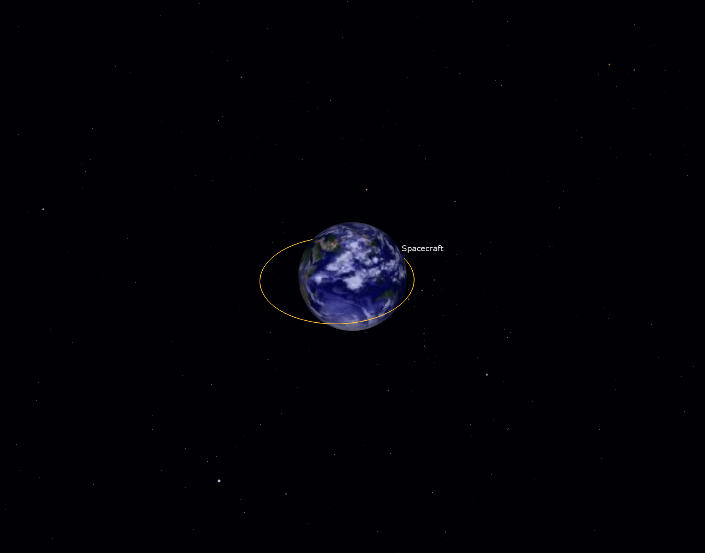
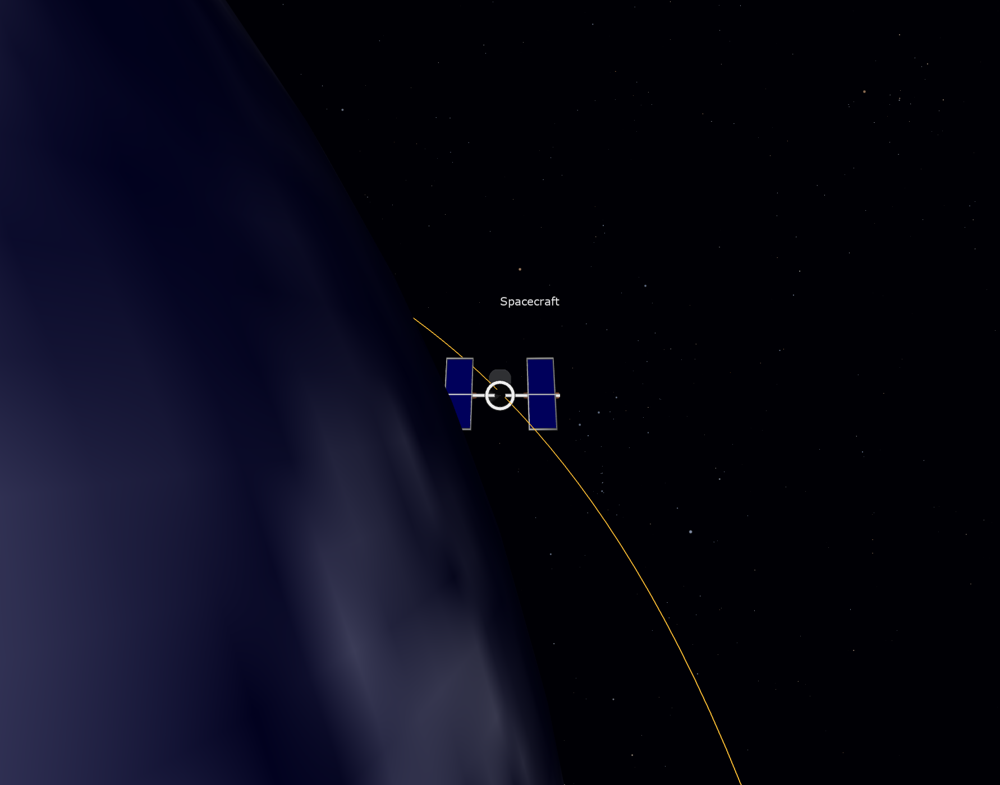

# OpenFrames in a qt-fortran GUI

A spacecraft orbiting the Earth, rendered by
[OpenFrames](https://github.com/ravidavi/OpenFrames) (on OpenSceneGraph) from
its own render thread into a qt-fortran window, next to a dock of qt-fortran
controls. OpenFrames is called through
[openframes-fortran](https://github.com/jacobwilliams/openframes-fortran).

| Earth view | Spacecraft view |
|---|---|
|  |  |

*(Frames saved by OpenFrames itself with `--capture`.)*

This is a separate project with its own pixi environment and `fpm.toml`. The
main qt-fortran project doesn't depend on OpenFrames or OpenSceneGraph.

## Running it

From this directory:

```sh
pixi run openframes    # once: clone OpenFrames (pinned commit) and build it into build/
pixi run build         # build the demo (fetches openframes-fortran, uses qt-fortran from ../..)
pixi run run           # run it
```

- **Mouse:** left drag rotates the view, right drag zooms, middle drag pans.
- **Controls dock:** sets the simulation time scale, pauses time, and switches
  between the Earth and spacecraft views.
- **Options:**
  - `pixi run run --view spacecraft` starts in the spacecraft view;
  - `--capture name` saves a rendered frame as `name_0_0.png` after 3 s;
  - `--quit-after seconds` closes the demo.

Tested on macOS (arm64). The environment also lists linux-64, which hasn't been tried yet.

## How it is put together

| Part | Where |
|---|---|
| Environment | `pixi.toml`: gfortran, fpm, Qt 6 (`qt6-main`), a C++ compiler, CMake, Ninja, and `openscenegraph` from conda-forge |
| OpenFrames | `demo.py openframes`: CMake build of the libraries only (`OpenFrames`, `OpenFrames_Interface_C`), installed into `build/openframes-install` |
| The demo | `fpm.toml` (depends on qt-fortran by path and openframes-fortran by git; links the two OpenFrames libraries) and `app/main.f90` |
| Building | `demo.py build/run` runs qt-fortran's `tools/fpm_qt.py` (C++ shim, Qt flags), adding the OpenFrames library path and an rpath to it. It also points `OPENFRAMES_DATA` at OpenFrames' `Demos` folder, for the textures, model and star catalog. |

The integration follows OpenFrames' own PySide one
(`OFInterfaces/PyQtOFInterfaceC.py` and `PyQtOF.py`):

- **Window and context.** The host owns a plain `QWindow` with an OpenGL
  surface and a `QOpenGLContext`. The window is embedded with
  `QWidget_createWindowContainer`.
- **Callbacks.** OpenFrames runs as an embedded window proxy
  (`ofwin_createproxy(..., embedded=.true., ...)`). It gets two `bind(C)`
  callbacks, `make_current` and `swap_buffers`, which its render thread calls
  every frame.
- **Events.** A `QtfEventFilter` on the window forwards its events:
  - the first expose starts OpenFrames (`ofwin_start`);
  - resizes go to `ofwin_resizewindow`;
  - mouse and keys go to `ofwin_buttonpress` and the like, in physical pixels
    (`devicePixelRatio`).
- **macOS.** Here `QOpenGLContext_supportsThreadedOpenGL()` is false: AppKit
  must attach the context to the window on the main thread. The demo
  therefore:
  - sets `Qt_AA_DontCheckOpenGLContextThreadAffinity`;
  - creates the context on the GUI thread;
  - at each expose and resize, pauses OpenFrames with `ofwin_pauseanimation`,
    which waits for the render thread, then calls `makeCurrent` +
    `doneCurrent` on the GUI thread and resumes.

  On Windows and Linux the context is created and used on the render thread.
- **Shutdown.** Closing the window stops the render thread (`ofwin_stop`)
  before Qt goes away; `of_cleanup` runs at exit.

## Notes

- **Call `of_initialize()` first.** The C interface needs it before
  `ofwin_createproxy`; without it that call crashes on a null pointer.
- **Set a curve artist's data sources yourself.** A `CurveArtist` created
  through the C interface has none, so it draws every point at the origin.
  Call `ofcurveartist_setxdata/ydata/zdata(of_posopt, ...)` to plot the
  trajectory's positions. The C++ API doesn't have this problem, because there
  the artist is constructed with its trajectory.
- **The "Unknown Chunk" lines** printed at startup come from OpenSceneGraph's
  3DS loader reading the Hubble model, and are harmless.
